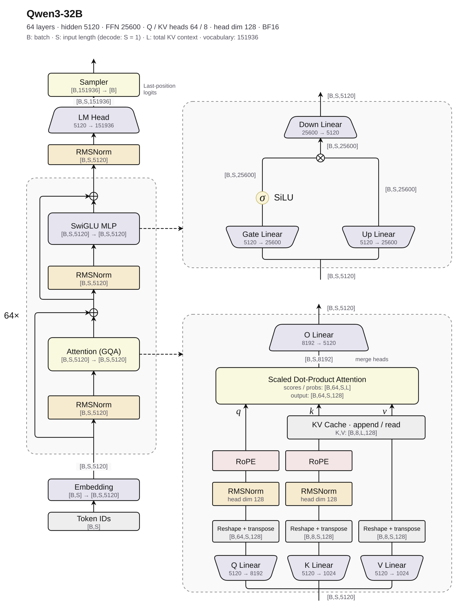

这个

# Qwen3-32B

<p align="center">
  
</p>

图从下向上阅读：左侧是整体推理流程，右侧展开单层 Decoder 的 SwiGLU MLP 和 GQA。Decoder 共重复 64 层，输入、输出和残差分支的 shape 均为 `[B,S,5120]`。

`B` 表示 batch size，`S` 表示本次输入的序列长度，`L` 表示包含已缓存 token 和当前输入的完整 KV 上下文长度。单 token decode 时 `S=1`；Attention 内部采用 `[B,heads,sequence,head_dim]` 的布局。

Q 投影将特征维度从 `5120` 扩展到 `8192`，拆分为 `64 × 128`；K/V 投影输出为 `1024`，拆分为 `8 × 128`，每个 KV head 对应 8 个 Q heads。MLP 的特征维度依次为 `5120 → 25600 → 5120`。图中的 Attention scores / probabilities 是逻辑中间结果，融合实现可以避免将它们完整写入显存。

> 结构与维度参考 [Qwen3-32B 官方配置](https://huggingface.co/Qwen/Qwen3-32B/blob/main/config.json) 和 [Transformers 参考实现](https://github.com/huggingface/transformers/blob/v4.51.3/src/transformers/models/qwen3/modeling_qwen3.py)。

以下以单 GPU、BF16 推理为基准，函数签名约定本项目的数据布局。`sampler` 参数由生成请求决定；`quant` 及量化融合算子用于可选的量化部署。采样与缓存操作参考 [vLLM sampler](https://github.com/vllm-project/vllm/blob/main/vllm/v1/sample/sampler.py) 和 [attention backend](https://github.com/vllm-project/vllm/tree/main/vllm/v1/attention/backends)。

## norm

### rmsnorm

隐藏状态上的 RMSNorm 对应 Decoder 中的两处归一化和模型末尾的 Final RMSNorm。

RMSNorm 沿最后一维计算均方根并归一化，再乘以可学习的缩放权重 `gamma`：

$$
r_m = \left(\frac{1}{N}\sum_{j=0}^{N-1}x_{m,j}^{2}+\epsilon\right)^{-\frac{1}{2}},
\qquad
y_{m,n}=x_{m,n}\,r_m\,\gamma_n
$$

每一行独立归一化，所有行共享同一组缩放权重。RMSNorm 不减去均值，也没有额外的偏置项。

输入 `x` 与输出 `y` 的 shape 均为 `[B,S,5120]`，展平前两维后按 `[M,N]` 处理，其中 `M=B×S`、`N=5120`。`gamma` 的 shape 为 `[N]`，沿最后一维广播。单 token decode 时 `S=1`，因此 `M=B`。

Q/K 的 head 内归一化复用同一算子：`N=128`，Q 的行数为 `B×S×64`，K 的行数为 `B×S×8`，两者分别使用一组 `[128]` 的权重。

平方和、均值和归一化因子使用 FP32 计算。为与 Qwen3 的 BF16 参考实现对齐，`x * r` 的结果先转换为 BF16，再与 BF16 的 `gamma` 相乘，得到 BF16 输出。

HIP kernel 函数签名：

```cpp
// x、y：[M,N]，按行连续存储，使用独立缓冲区。
// gamma：[N]，所有行共享。
// rows = M = B×S；hidden_size = N = 5120；eps = 1e-6。
__global__ void rmsnorm_kernel(const hip_bfloat16* x, const hip_bfloat16* gamma,
                               hip_bfloat16* y, int rows, int hidden_size,
                               float eps);
```

### add_rmsnorm

融合残差加法与 RMSNorm，对应 Qwen3 的 Attention 输出后、层间和模型末尾的归一化：

$$
\begin{aligned}
s_{m,n} &= x_{m,n} + \mathrm{residual}_{m,n}, \\
r_m &= \left(\frac{1}{N}\sum_{j=0}^{N-1}s_{m,j}^{2}+\epsilon\right)^{-\frac{1}{2}}, \\
y_{m,n} &= s_{m,n}\,r_m\,\gamma_n.
\end{aligned}
$$

`x`、`residual` 与两路输出均为 `[M,N]`，`gamma` 为 `[N]`。原地写回 `x ← y`、`residual ← s`，其中 `s` 保留给后续残差连接使用。

残差相加结果先舍入为 BF16，后续归一化沿用上述 RMSNorm 的 FP32 计算与 BF16 舍入约定。

HIP kernel 函数签名：

```cpp
// x：[M,N]，输入隐藏状态，写回归一化结果 y。
// residual：[M,N]，输入残差，写回更新后的残差 s。
// x 与 residual 使用独立缓冲区；gamma：[N]，所有行共享。
// rows = M = B×S；hidden_size = N = 5120；eps = 1e-6。
__global__ void add_rmsnorm_kernel(hip_bfloat16* x, hip_bfloat16* residual,
                                   const hip_bfloat16* gamma, int rows,
                                   int hidden_size, float eps);
```

## elementwise

### add

逐元素相加，对应 Attention/MLP 输出与残差相加：

$$
y_i = a_i+b_i
$$

模型输入输出均为 `[M,5120]`。输入输出使用 BF16，FP32 加法结果舍入为 BF16；`add.hip` 使用同一接口，也支持任意长度的连续数组。

HIP kernel 函数签名：

```cpp
// a、b、y：[M,5120]，BF16，连续存储，各自使用独立缓冲区。
// n = M * 5120，展平后的元素总数；M = B×S。
__global__ void add_kernel(const hip_bfloat16* a, const hip_bfloat16* b,
                           hip_bfloat16* y, size_t n);
```

### silu

SiLU 对输入逐元素计算激活，对应 Qwen3 MLP 中 `gate_proj` 输出后的激活：

$$
y_i = \operatorname{SiLU}(x_i) = \frac{x_i}{1+e^{-x_i}}
$$

输入 `x` 与输出 `y` 均为 `[M,25600]`，其中 `M=B×S`，展平后按连续数组处理。使用 BF16 存储，激活值使用 FP32 计算，结果转换为 BF16。

HIP kernel 函数签名：

```cpp
// x、y：[M,25600]，BF16，连续存储，使用独立缓冲区。
// n = M * 25600，展平后的元素总数。
__global__ void silu_kernel(const hip_bfloat16* x, hip_bfloat16* y, size_t n);
```

### mul

逐元素相乘，对应 Qwen3 MLP 中 SiLU 的输出与 `up_proj` 输出相乘：

$$
y_i = a_i\,b_i
$$

输入 `a`、`b` 与输出 `y` 均为 `[M,25600]`，展平后按连续数组处理。使用 BF16 存储，乘法使用 FP32 计算，结果转换为 BF16。

HIP kernel 函数签名：

```cpp
// a、b、y：[M,25600]，BF16，各自使用独立的连续缓冲区。
// n = M * 25600，展平后的元素总数。
__global__ void mul_kernel(const hip_bfloat16* a, const hip_bfloat16* b,
                           hip_bfloat16* y, size_t n);
```

### silu_mul

融合 SiLU 与逐元素乘法，完成 Qwen3 MLP 的门控激活，输出送入 `down_proj`：

$$
y_i = \operatorname{SiLU}(\mathrm{gate}_i)\,\mathrm{up}_i
    = \frac{\mathrm{gate}_i}{1+e^{-\mathrm{gate}_i}}\,\mathrm{up}_i
$$

`gate`、`up` 分别来自 `gate_proj`、`up_proj`，与输出 `y` 的 shape 均为 `[M,25600]`。沿用单独 SiLU 后接乘法的 BF16 精度约定：SiLU 使用 FP32 计算，其结果先舍入为 BF16，再与 BF16 的 `up` 相乘，得到 BF16 输出。

HIP kernel 函数签名：

```cpp
// gate、up、y：[M,25600]，BF16，各自使用独立的连续缓冲区。
// n = M * 25600，展平后的元素总数。
__global__ void silu_mul_kernel(const hip_bfloat16* gate,
                                const hip_bfloat16* up, hip_bfloat16* y,
                                size_t n);
```

### softmax

Softmax 沿最后一维将分数归一化为概率，用于 Attention 权重计算和采样。每行包含最大值和求和归约，先减去最大值以提高数值稳定性：

$$
a_m = \max_{0\le j<N}x_{m,j},
\qquad
y_{m,n} = \frac{e^{x_{m,n}-a_m}}{\sum_{j=0}^{N-1}e^{x_{m,j}-a_m}}
$$

输入 `x` 与输出 `y` 均为 `[M,N]`。对于 Qwen3-32B 的 Attention scores，`[B,64,S,L]` 展平为 `[B×64×S,L]`，沿 KV 上下文维度 `L` 归一化。

Attention 的独立 Softmax 接口使用 BF16 输入输出，采样接口使用 FP32 输入输出。最大值、指数和求和均使用 FP32 计算；每行至少有一个有限的分数。

HIP kernel 函数签名：

```cpp
// x、y：[M,N]，BF16，按行连续存储，使用独立缓冲区。
// rows = M = B×64×S；cols = N = L，沿最后一维归一化。
__global__ void softmax_kernel(const hip_bfloat16* x, hip_bfloat16* y, int rows,
                               int cols);

// FP32 路径用于 sampler；x、y：[rows,cols]，连续存储，独立缓冲区。
// rows 为采样请求数；cols 为词表大小 151936 或筛选后的候选数量。
__global__ void softmax_kernel(const float* x, float* y, int rows, int cols);
```

## matmul

### gemm

GEMM 计算矩阵乘积，对应 Qwen3 中的各个线性投影：

$$
C = AB,
\qquad
C_{m,n} = \sum_{j=0}^{K-1}A_{m,j}\,B_{j,n}
$$

输入 `a` 为 `[M,K]`、`b` 为 `[K,N]`，输出 `c` 为 `[M,N]`，均按行连续存储。线性投影中 `M` 为本次处理的 token 数，各投影的 `(K,N)` 为：

- `q_proj`：`(5120,8192)`；`k_proj` / `v_proj`：`(5120,1024)`。
- `o_proj`：`(8192,5120)`。
- `gate_proj` / `up_proj`：`(5120,25600)`；`down_proj`：`(25600,5120)`。
- `lm_head`：`(5120,151936)`，输出 logits；仅采样时可只处理各请求的目标 token 行。

PyTorch Linear 的权重存储为 `[N,K]`，模型计算 `XWᵀ`；这里的 GEMM 接口约定 `b` 为 `[K,N]`。输入输出使用 BF16，乘加使用 FP32 累加，结果转换为 BF16。小 `M` 场景的优化归入 GEMM 的进阶范围。

HIP kernel 函数签名：

```cpp
// a：[M,K]；b：[K,N]；c：[M,N]，BF16，行主序，独立缓冲区。
// m、n、k：矩阵维度 M、N、K；线性投影时 m = B×S。
__global__ void gemm_kernel(const hip_bfloat16* a, const hip_bfloat16* b,
                            hip_bfloat16* c, int m, int n, int k);
```

### gemv

GEMV 计算矩阵与向量的乘积，对应单个 token 的线性投影：

$$
y = Wx,
\qquad
y_n = \sum_{j=0}^{K-1}W_{n,j}\,x_j
$$

权重 `weight` 为 `[N,K]`，输入 `x` 为 `[K]`，输出 `y` 为 `[N]`。权重沿用 PyTorch Linear 的行主序布局；输入输出使用 BF16，乘加使用 FP32 累加，结果转换为 BF16。

单 token decode 时 `M=B`：`B=1` 可使用 GEMV，`B>1` 属于小 `M` GEMM。

HIP kernel 函数签名：

```cpp
// weight：[N,K]，BF16，行主序。
// x：[K]；y：[N]，BF16，连续存储，各输入输出使用独立缓冲区。
// n、k：输出维度 N、输入维度 K。
__global__ void gemv_kernel(const hip_bfloat16* weight, const hip_bfloat16* x,
                            hip_bfloat16* y, int n, int k);
```

## rope_cache

### rope

RoPE 对 Q/K 应用旋转位置编码，按每个 head 的前后半维配对。`F` 为 head 维度的一半，配对索引满足 `0≤i<F`；`Θ` 为 RoPE 基数，`p` 为 token 位置。Qwen3 取 `D=128`、`F=64`、`Θ=1000000`：

$$
\begin{aligned}
\theta_{p,i} &= p\,\Theta^{-i/F}, \\
x'_i &= x_i\cos\theta_{p,i}-x_{i+F}\sin\theta_{p,i}, \\
x'_{i+F} &= x_i\sin\theta_{p,i}+x_{i+F}\cos\theta_{p,i}.
\end{aligned}
$$

输入 `x` 按 `[T,H,128]` 连续存储并原地写回，其中 `T=B×S`，Q 使用 `H=64`，K 使用 `H=8`。`positions` 为 `[T]`，保存各 token 的位置；预计算的 `cos`、`sin` 均为 `[P,64]`，`P` 为位置表长度，同一位置的系数由所有 heads 共享。

输入输出与 cos/sin 使用 BF16。沿用 Transformers 的 BF16 路径：cos/sin 先在 FP32 中计算再舍入为 BF16，两项旋转乘积分别舍入为 BF16，再相加写回。

HIP kernel 函数签名：

```cpp
// x：[T,H,D]，BF16，token/head/维度依次连续，原地写回。
// positions：[T]，int64_t，取值对应 cos/sin 的位置行。
// cos、sin：[P,D/2]，BF16，按行连续存储。
// tokens = T = B×S；heads = H = 64 或 8；head_size = D = 128。
__global__ void rope_kernel(hip_bfloat16* x, const int64_t* positions,
                            const hip_bfloat16* cos, const hip_bfloat16* sin,
                            int tokens, int heads, int head_size);
```

### qk_rope

在一次 kernel 调用中同时旋转 Q/K，共享位置索引与 cos/sin：

$$
Q' = \operatorname{RoPE}(Q),
\qquad
K' = \operatorname{RoPE}(K)
$$

`q` 为 `[T,64,128]`，`k` 为 `[T,8,128]`，均按 token/head/维度连续存储并原地写回。位置表、旋转公式与精度约定沿用 `rope`。

HIP kernel 函数签名：

```cpp
// q：[T,Hq,D]；k：[T,Hkv,D]，BF16，连续存储，独立缓冲区，原地写回。
// positions：[T]，int64_t；cos、sin：[P,D/2]，BF16。
// tokens = T = B×S；q_heads = Hq = 64；kv_heads = Hkv = 8。
// head_size = D = 128。
__global__ void qk_rope_kernel(hip_bfloat16* q, hip_bfloat16* k,
                               const int64_t* positions,
                               const hip_bfloat16* cos, const hip_bfloat16* sin,
                               int tokens, int q_heads, int kv_heads,
                               int head_size);
```

### cache_write

将旋转后的 K 与原始 V 写入当前 token 对应的缓存槽位：

$$
\mathrm{KCache}_{s_t}=K_t,
\qquad
\mathrm{VCache}_{s_t}=V_t,
\qquad
s_t=\mathrm{slot\_mapping}_t
$$

K/V 输入为 `[T,8,128]`，缓存为 `[C,8,128]`。分页时也可将同一缓存视为 `[num_blocks,block_size,8,128]`，`C=num_blocks×block_size`；物理槽位为 `block_id×block_size+offset`。数据使用 BF16。

HIP kernel 函数签名：

```cpp
// k、v：[T,Hkv,D]，BF16；k 已完成 RoPE。
// k_cache、v_cache：[C,Hkv,D]，BF16，按槽位/head/维度连续存储。
// slot_mapping：[T]，int64_t，槽位位于 [0,C)，本次写入互不重复。
// tokens = T；kv_heads = Hkv = 8；head_size = D = 128。
__global__ void cache_write_kernel(const hip_bfloat16* k, const hip_bfloat16* v,
                                   const int64_t* slot_mapping,
                                   hip_bfloat16* k_cache, hip_bfloat16* v_cache,
                                   int tokens, int kv_heads, int head_size);
```

### qk_rope_cache

融合 Q/K 的 RoPE 与 K/V 缓存写入。token `t` 的位置为 `p_t = positions[t]`，缓存槽位为 `s_t = slot_mapping[t]`：

$$
\begin{aligned}
Q'_t &= \operatorname{RoPE}(Q_t,p_t), &
K'_t &= \operatorname{RoPE}(K_t,p_t), \\
\mathrm{KCache}_{s_t} &= K'_t, &
\mathrm{VCache}_{s_t} &= V_t.
\end{aligned}
$$

`q` 为 `[T,64,128]`，`k`、`v` 为 `[T,8,128]`。`q` 原地写回旋转结果，旋转后的 K 与原始 V 写入缓存；`k_cache`、`v_cache` 均采用 `[C,8,128]` 的连续槽位布局，`C` 为缓存容量。RoPE 的位置表与精度约定沿用 `rope`，缓存数据使用 BF16。

HIP kernel 函数签名：

```cpp
// q：[T,Hq,D]，BF16，连续存储，原地写回旋转结果。
// k、v：[T,Hkv,D]，BF16，连续存储。
// k_cache、v_cache：[C,Hkv,D]，BF16，按槽位/head/维度连续存储。
// positions：[T]，int64_t，用于查找 RoPE 系数。
// slot_mapping：[T]，int64_t，写入槽位位于 [0,C)，本次写入互不重复。
// cos、sin：[P,D/2]，BF16；各输入与缓存使用独立缓冲区。
// tokens = T = B×S；q_heads = Hq = 64；kv_heads = Hkv = 8。
// head_size = D = 128。
__global__ void qk_rope_cache_kernel(
    hip_bfloat16* q, const hip_bfloat16* k, const hip_bfloat16* v,
    const int64_t* positions, const int64_t* slot_mapping,
    const hip_bfloat16* cos, const hip_bfloat16* sin, hip_bfloat16* k_cache,
    hip_bfloat16* v_cache, int tokens, int q_heads, int kv_heads,
    int head_size);
```

## attention

### attention

缩放点积注意力，使用 Qwen3 的 GQA 与 causal mask：

$$
\begin{aligned}
G&=\frac{H_q}{H_{kv}}, &
g(h)&=\left\lfloor\frac{h}{G}\right\rfloor, \\
Z_{b,h,i,j}&=\frac{Q_{b,h,i}\cdot K_{b,g(h),j}}{\sqrt{D}}+\mathrm{mask}_{b,i,j}, \\
P_{b,h,i,:}&=\operatorname{softmax}(Z_{b,h,i,:}), &
O_{b,h,i}&=\sum_j P_{b,h,i,j}\,V_{b,g(h),j}.
\end{aligned}
$$

Q 为 `[B,64,S,128]`，K/V 为 `[B,8,L,128]`，输出为 `[B,64,S,128]`。每 8 个 Q heads 共享一个 KV head。请求 `b` 的有效上下文长度为 `context_lens[b]`，当前查询块起点为 `query_start[b]`；查询 `i` 可访问 `j<context_lens[b]` 且 `j≤query_start[b]+i` 的 key，其余分数置为负无穷。

Q/K 已完成 head 内 RMSNorm 与 RoPE。输入输出使用 BF16，点积、Softmax 和加权求和使用 FP32；融合计算与拆分参考的中间 BF16 舍入可能产生数值差异。

HIP kernel 函数签名：

```cpp
// q：[B,Hq,S,D]；k、v：[B,Hkv,L,D]；out：[B,Hq,S,D]，BF16。
// 张量各自连续存储，输入输出使用独立缓冲区。
// context_lens、query_start：[B]，int32_t，分别为有效 KV 长度和查询起点。
// 每个请求满足 0 <= query_start，query_start + query_len <= context_lens。
// context_lens <= kv_len；所有长度均为正数。
// batch_size = B；q_heads = Hq = 64；kv_heads = Hkv = 8。
// query_len = S；kv_len = L（容量）；head_size = D = 128。
// scale = 1 / sqrt(D)；causal mask 由长度与查询起点确定。
__global__ void attention_kernel(const hip_bfloat16* q, const hip_bfloat16* k,
                                 const hip_bfloat16* v, hip_bfloat16* out,
                                 const int32_t* context_lens,
                                 const int32_t* query_start, int batch_size,
                                 int q_heads, int kv_heads, int query_len,
                                 int kv_len, int head_size, float scale);
```

### flash_attention

分块计算 Attention，并在线维护 Softmax 的最大值、指数和与加权和，避免完整写出 `[B,64,S,L]` 的分数和概率矩阵：

$$
m=\max_j z_j,
\qquad
\ell=\sum_j e^{z_j-m},
\qquad
u=\sum_j e^{z_j-m}V_j,
\qquad
O=\frac{u}{\ell}
$$

上述统计针对单个 query/head，`z_j` 为其分数，`V_j` 来自对应的 KV head。输入输出布局、GQA 和 causal 规则沿用 `attention`。在线统计与加权累积使用 FP32，输出使用 BF16；接口同时覆盖 prefill 与 `S=1` 的 decode。

HIP kernel 函数签名：

```cpp
// q：[B,Hq,S,D]；k、v：[B,Hkv,L,D]；out：[B,Hq,S,D]，BF16，连续存储。
// context_lens、query_start：[B]，int32_t；有效范围沿用 attention。
// batch_size = B；q_heads = Hq = 64；kv_heads = Hkv = 8。
// query_len = S；kv_len = L；head_size = D = 128；scale = 1 / sqrt(D)。
// 输入输出使用独立缓冲区。
__global__ void flash_attention_kernel(
    const hip_bfloat16* q, const hip_bfloat16* k, const hip_bfloat16* v,
    hip_bfloat16* out, const int32_t* context_lens, const int32_t* query_start,
    int batch_size, int q_heads, int kv_heads, int query_len, int kv_len,
    int head_size, float scale);
```

### paged_attention

通过 block table 访问分页 KV cache，计算与 `attention` 相同的 GQA 注意力。逻辑 key 位置 `j` 对应的物理页与页内偏移为：

$$
\mathrm{block}_{b,j}
=\mathrm{block\_table}_{b,\lfloor j/P_b\rfloor},
\qquad
\mathrm{offset}_j=j\bmod P_b
$$

Q 与输出为 `[B,64,S,128]`；K/V cache 为 `[num_blocks,P_b,8,128]`，`P_b` 为 block size。缓存布局与 `cache_write` 的平面槽位布局对应。每个请求的有效长度与 causal 范围沿用 `attention`；`S=1` 时直接对历史缓存执行 decode。

BF16 数据读取后使用 FP32 计算分数、Softmax 与加权和，输出转换为 BF16。

HIP kernel 函数签名：

```cpp
// q、out：[B,Hq,S,D]，BF16，连续存储，独立缓冲区。
// k_cache、v_cache：[num_blocks,block_size,Hkv,D]，BF16，连续存储。
// block_table：[B,max_blocks]，int32_t，映射逻辑页号到有效物理页号。
// context_lens、query_start：[B]，int32_t，有效范围沿用 attention。
// 每行 block_table 至少包含 ceil(context_lens / block_size) 个有效页。
// batch_size = B；q_heads = Hq = 64；kv_heads = Hkv = 8。
// query_len = S；head_size = D = 128；scale = 1 / sqrt(D)。
__global__ void paged_attention_kernel(
    const hip_bfloat16* q, const hip_bfloat16* k_cache,
    const hip_bfloat16* v_cache, const int32_t* block_table,
    const int32_t* context_lens, const int32_t* query_start, hip_bfloat16* out,
    int batch_size, int q_heads, int kv_heads, int query_len, int head_size,
    int block_size, int max_blocks, float scale);
```

## sampler

采样输入为 `[R,V]` 的 FP32 logits，`R` 为本次采样行数，通常等于 batch size，`V=151936`。每行至少保留一个有效 token；温度、惩罚和筛选参数由生成请求决定。

### temperature

用温度调整 logits：

$$
L'_{r,v}=\frac{L_{r,v}}{\tau_r}
$$

输入输出均为 `[R,V]`，原地更新，使用 FP32。`τ>0`；温度为 0 的请求使用 `greedy`。

HIP kernel 函数签名：

```cpp
// logits：[R,V]，FP32，按行连续存储，原地更新。
// temperatures：[R]，FP32，每行温度 > 0。
// rows = R；vocab_size = V = 151936。
__global__ void temperature_kernel(float* logits, const float* temperatures,
                                   int rows, int vocab_size);
```

### penalties

合并 repetition、frequency 与 presence penalty，系数分别为 `ρ`、`f`、`a`。`c` 为已生成 token 的出现次数，`seen` 表示 token 在 prompt 或已生成序列中出现过：

$$
\widetilde L_{r,v}=
\begin{cases}
L_{r,v}/\rho_r,&\mathrm{seen}_{r,v}\land L_{r,v}>0,\\
L_{r,v}\rho_r,&\mathrm{seen}_{r,v}\land L_{r,v}\le0,\\
L_{r,v},&\neg\mathrm{seen}_{r,v},
\end{cases}
\qquad
L'_{r,v}=\widetilde L_{r,v}-f_r c_{r,v}-a_r\mathbf{1}[c_{r,v}>0]
$$

logits 原地更新为 `[R,V]`。重复惩罚使用 prompt 与生成历史的并集，频率和存在惩罚使用生成历史。计算使用 FP32；`ρ=1`、`f=a=0` 表示关闭对应惩罚。

HIP kernel 函数签名：

```cpp
// logits：[R,V]，FP32，原地更新。
// prompt_seen：[R,V]，uint8_t；output_counts：[R,V]，int32_t，非负次数。
// repetition、frequency、presence：[R]，FP32；repetition > 0。
// 各矩阵按行连续存储；rows = R；vocab_size = V = 151936。
__global__ void penalties_kernel(float* logits, const uint8_t* prompt_seen,
                                 const int32_t* output_counts,
                                 const float* repetition,
                                 const float* frequency, const float* presence,
                                 int rows, int vocab_size);
```

### greedy

选择每行最大 logit 对应的 token：

$$
\mathrm{token}_r=\operatorname*{arg\,max}_{0\le v<V}L_{r,v}
$$

输入为 `[R,V]` 的 FP32 logits，输出为 `[R]` 的 token ID。值相同时选择较小的 token ID。

HIP kernel 函数签名：

```cpp
// logits：[R,V]，FP32，按行连续存储。
// token_ids：[R]，int64_t；并列最大值选择较小的 ID。
// rows = R；vocab_size = V = 151936。
__global__ void greedy_kernel(const float* logits, int64_t* token_ids, int rows,
                              int vocab_size);
```

### top_k

保留每行分数最高的 `k` 个 token，其余 logits 置为负无穷：

$$
L'_{r,v}=\begin{cases}
L_{r,v},&v\in\operatorname{TopK}(L_r,k_r),\\
-\infty,&\text{其余 token}.
\end{cases}
$$

输入输出均为 `[R,V]` 的 FP32 logits，输出保持原词表顺序。并列分数按 token ID 从小到大取舍；`k=0` 表示保留全部 token。

HIP kernel 函数签名：

```cpp
// logits、filtered_logits：[R,V]，FP32，连续存储，独立缓冲区。
// top_k：[R]，int32_t，取值 0..V；0 表示关闭筛选。
// rows = R；vocab_size = V = 151936。
__global__ void top_k_kernel(const float* logits, const int32_t* top_k,
                             float* filtered_logits, int rows, int vocab_size);
```

### top_p

按概率降序选择累计概率达到阈值的最短前缀，并重新归一化：

$$
t_r=\sum_{v=0}^{V-1}P_{r,v},
\qquad
k_r=\min\left\{k\ge1:\sum_{i=0}^{k-1}P_{r,\pi_i}\ge p_r t_r\right\},
\qquad
Q_{r,v}=\begin{cases}
\displaystyle\frac{P_{r,v}}{\sum_{i=0}^{k_r-1}P_{r,\pi_i}},
&v\in\{\pi_0,\ldots,\pi_{k_r-1}\},\\
0,&\text{其余 token}.
\end{cases}
$$

`π` 按概率降序排列，并列时按 token ID 升序排列。输入输出均为 `[R,V]` 的 FP32 概率，输出保持原词表顺序；`0<p≤1`，包含跨过阈值的那个 token。阈值按每行总质量 `t` 计算，避免归一化的舍入误差。

HIP kernel 函数签名：

```cpp
// probs、filtered_probs：[R,V]，FP32，连续存储，独立缓冲区。
// probs 每行非负且归一化；top_p：[R]，FP32，取值 (0,1]。
// rows = R；vocab_size = V = 151936。
__global__ void top_p_kernel(const float* probs, const float* top_p,
                             float* filtered_probs, int rows, int vocab_size);
```

### sample

按每行概率分布采样 token，使用均匀随机数查找累积分布：

$$
F_{r,j}=\frac{\sum_{v=0}^{j}P_{r,v}}{\sum_{v=0}^{V-1}P_{r,v}},
\qquad
\mathrm{token}_r=\min\{j:F_{r,j}>u_r\},
\quad u_r\sim\mathcal{U}[0,1)
$$

输入权重为 `[R,V]`，随机数和输出 token ID 均为 `[R]`。权重非负且每行总质量大于 0；随机数由调用方提供，计算使用 FP32。

HIP kernel 函数签名：

```cpp
// probs：[R,V]，FP32，按原词表顺序连续存储，每行总质量 > 0。
// uniforms：[R]，FP32，取值 [0,1)；token_ids：[R]，int64_t。
// rows = R；vocab_size = V = 151936。
__global__ void sample_kernel(const float* probs, const float* uniforms,
                              int64_t* token_ids, int rows, int vocab_size);
```

### topk_topp_sample

融合温度、Top-k、Softmax、Top-p 与随机采样：

$$
Q=\operatorname{TopP}\left(
\operatorname{softmax}\left(\operatorname{TopK}(L/\tau,k)\right),p\right),
\qquad
\mathrm{token}\sim\operatorname{Categorical}(Q)
$$

输入为 `[R,V]` 的 FP32 logits，输出为 `[R]` 的 token ID。先完成所需惩罚，再调用此融合算子；筛选、并列值与随机数规则沿用上述算子。温度为 0 的行返回 greedy 结果。

HIP kernel 函数签名：

```cpp
// logits：[R,V]，FP32，已应用所需惩罚，按行连续存储。
// temperatures、top_p、uniforms：[R]，FP32；temperatures >= 0。
// top_p 位于 (0,1]；uniforms 位于 [0,1)；top_k：[R]，int32_t，取值 0..V。
// token_ids：[R]，int64_t；rows = R；vocab_size = V = 151936。
__global__ void topk_topp_sample_kernel(
    const float* logits, const float* temperatures, const int32_t* top_k,
    const float* top_p, const float* uniforms, int64_t* token_ids, int rows,
    int vocab_size);
```

## quant

INT8 以 [SmoothQuant](https://github.com/mit-han-lab/smoothquant) 的 W8A8 路径为例，采用动态逐 token 激活量化与逐输出通道权重量化。INT4 以 [AWQ](https://github.com/mit-han-lab/llm-awq) / [GPTQ](https://github.com/IST-DASLab/gptq) 的 W4A16 路径为例，权重沿输入维度分组，激活保持 BF16。

校准与权重处理在离线阶段完成，以下接口描述量化编码与推理计算。尺度使用 FP32，INT4 采用本项目统一的半字节布局；加载 AWQ/GPTQ checkpoint 时需转换其打包格式与零点编码。

### quant_int8

SmoothQuant 通过通道缩放，将激活中的异常值幅度转移到权重。`a_k` 为校准激活的逐通道最大绝对值，`b_k` 为对应权重列的最大绝对值，`α` 控制两者的平衡：

$$
\begin{aligned}
d_k &= \frac{a_k^{\alpha}}{b_k^{1-\alpha}}, \\
\widetilde X_{m,k} &= X_{m,k}/d_k, &
\widetilde W_{n,k} &= W_{n,k}\,d_k, \\
XW^{\mathsf T} &= \widetilde X\widetilde W^{\mathsf T}.
\end{aligned}
$$

`d` 为 `[K]` 的离线通道尺度，`0≤α≤1`；计算时用正数 `δ` 约束分母与尺度下界。权重缩放后离线量化，激活在推理时按行动态量化：

$$
u_{r,j}=x_{r,j}/d_j,
\qquad
a_r=\max_j|u_{r,j}|,
\qquad
s_r=\frac{a_r}{q_{\max}},
\qquad
q_{r,j}=\operatorname{clip}\left(
\operatorname{RNE}(u_{r,j}/s_r),-q_{\max},q_{\max}\right)
$$

`RNE` 表示就近舍入，并列时取偶数。`q_max=127`，全零行取 `s=1`。激活输入为 `[M,K]` 的 BF16，输出为同 shape 的 INT8，动态尺度为 `[M]`；缩放与量化使用 FP32。缩放后的权重 `[N,K]` 也按行量化，其尺度为 `[N]`。

若通道缩放已吸收到前序算子，或输入是已缩放的权重，则直接令 `u=x`，避免重复缩放。`d` 是离线通道尺度，`s` 是量化尺度，两者用途不同。

HIP kernel 函数签名：

```cpp
// x：[rows,cols]，BF16；q：[rows,cols]，INT8，按行连续存储。
// channel_scales：[cols]，FP32，正数，对输入逐列除以 d。
// channel_scales 为 nullptr 时跳过通道缩放。
// scales：[rows]，FP32；各输入输出使用独立缓冲区。
// 激活量化时 rows = M、cols = K；权重量化时 rows = N、cols = K。
__global__ void quant_int8_kernel(const hip_bfloat16* x,
                                  const float* channel_scales, int8_t* q,
                                  float* scales, int rows, int cols);
```

### quant_int4

AWQ 利用激活统计搜索通道缩放与权重裁剪，GPTQ 利用近似二阶信息逐列量化并补偿误差。两者的分组 INT4 权重均可表示为量化值 `q`、尺度 `s` 与零点 `z`。

按离线流程给定的组尺度与零点，将权重编码为 INT4：

$$
g=\left\lfloor\frac{j}{G_s}\right\rfloor,
\qquad
\begin{aligned}
q_{n,j} &= \operatorname{clip}\left(
\operatorname{RNE}(W^{\star}_{n,j}/s_{n,g})+z_{n,g},q_{\min},q_{\max}\right), \\
\widehat W_{n,j} &= s_{n,g}(q_{n,j}-z_{n,g}).
\end{aligned}
$$

`W*` 表示送入舍入步骤的权重，已完成 AWQ 的缩放/裁剪或 GPTQ 在该步骤之前的误差补偿。此接口执行给定参数下的编码与打包；已量化模型直接加载其量化值和参数。

采用连续分组，GPTQ 先以关闭 act-order 的配置为例。组宽为 `G_s`，通常取 128；权重为 `[N,K]`，尺度与零点为 `[N,K/G_s]`，打包输出为 `[N,K/2]`。INT4 取 `q_min=0`、`q_max=15`；GPTQ 的对称量化也可用固定零点表示。每字节低 4 位存偶数列，高 4 位存奇数列。

HIP kernel 函数签名：

```cpp
// weight：[N,K]，FP32，离线处理后的编码输入；packed：[N,K/2]，uint8_t。
// scales：[N,K/group_size]，FP32，正数，离线给定。
// zero_points：同 shape，uint8_t，实际零点，取值 0..15。
// rows = N；cols = K；group_size = Gs，默认 128。
// cols 为偶数，且可被正数 group_size 整除；输入输出使用独立缓冲区。
__global__ void quant_int4_kernel(const float* weight, const float* scales,
                                  const uint8_t* zero_points, uint8_t* packed,
                                  int rows, int cols, int group_size);
```

### rmsnorm_quant

融合 RMSNorm 与逐行 INT8 量化，用于量化 Linear 前的激活处理：

$$
Y = \operatorname{RMSNorm}(X,\gamma,\epsilon),
\qquad
(Q,s) = \operatorname{QuantINT8}(Y)
$$

`x`、量化输出 `q` 均为 `[M,N]`，`gamma` 为 `[N]`，`scales` 为 `[M]`。归一化沿用 `rmsnorm` 的 BF16 舍入约定，量化采用 `quant_int8` 的逐行对称规则。用于 SmoothQuant 时，通道缩放预先吸收到 `gamma`，配套 Linear 的权重同步变换。

HIP kernel 函数签名：

```cpp
// x：[M,N]；gamma：[N]，BF16。
// q：[M,N]，INT8；scales：[M]，FP32，保存每行量化尺度。
// 所有矩阵按行连续存储，输入输出使用独立缓冲区。
// rows = M；hidden_size = N，隐藏状态为 5120；eps = 1e-6。
__global__ void rmsnorm_quant_kernel(const hip_bfloat16* x,
                                     const hip_bfloat16* gamma, int8_t* q,
                                     float* scales, int rows, int hidden_size,
                                     float eps);
```

### add_rmsnorm_quant

融合残差加法、RMSNorm 与逐行 INT8 量化：

$$
R' = \operatorname{BF16}(X+R),
\qquad
(Q,s) = \operatorname{QuantINT8}(\operatorname{RMSNorm}(R',\gamma,\epsilon))
$$

`x`、`residual`、量化输出 `q` 均为 `[M,N]`。`residual` 原地写回 BF16 的 `R'`，`q` 保存 INT8 的归一化结果，`scales` 为 `[M]`。归一化与量化规则分别沿用 `add_rmsnorm`、`quant_int8`；SmoothQuant 的通道缩放可预先吸收到 `gamma`。

HIP kernel 函数签名：

```cpp
// x、residual：[M,N]，BF16；residual 原地更新。
// gamma：[N]，BF16；q：[M,N]，INT8；scales：[M]，FP32。
// 按行连续存储，各输入与输出使用独立缓冲区。
// rows = M；hidden_size = N = 5120；eps = 1e-6。
__global__ void add_rmsnorm_quant_kernel(const hip_bfloat16* x,
                                         hip_bfloat16* residual,
                                         const hip_bfloat16* gamma, int8_t* q,
                                         float* scales, int rows,
                                         int hidden_size, float eps);
```

### gemm_int8

使用 SmoothQuant 变换后的 INT8 激活与 INT8 权重执行 W8A8 矩阵乘法：

$$
C_{m,n}=s^A_m s^W_n\sum_j Q^A_{m,j}\,Q^W_{n,j}
$$

`Q^A`、`Q^W` 分别量化自缩放后的激活与权重，shape 为 `[M,K]`、`[N,K]`，量化尺度 `s^A`、`s^W` 分别为 `[M]`、`[N]`。整数乘加使用 INT32 累加，再应用 FP32 尺度，输出 BF16 的 `[M,N]`；通道缩放已在量化前完成。

HIP kernel 函数签名：

```cpp
// a：[M,K]；weight：[N,K]，INT8，行主序。
// a_scales：[M]；weight_scales：[N]，FP32。
// out：[M,N]，BF16，行主序；输入输出使用独立缓冲区。
// m、n、k：矩阵维度 M、N、K，线性投影尺寸沿用 gemm。
__global__ void gemm_int8_kernel(const int8_t* a, const int8_t* weight,
                                 const float* a_scales,
                                 const float* weight_scales, hip_bfloat16* out,
                                 int m, int n, int k);
```

### gemm_int4

融合 AWQ/GPTQ 的分组 INT4 权重反量化与矩阵乘法，执行 W4A16 线性投影：

$$
\widehat W_{n,j}=\operatorname{BF16}\left(
s_{n,g}(q_{n,j}-z_{n,g})\right),
\qquad
C_{m,n}=\sum_j A_{m,j}\,\widehat W_{n,j}
$$

激活为 `[M,K]` 的 BF16，权重打包为 `[N,K/2]`，尺度和零点为 `[N,K/G_s]`，格式与连续分组约定沿用 `quant_int4`。AWQ 的激活需完成与量化权重配套的通道缩放，可吸收到前序算子；GPTQ 使用原始激活。

权重恢复为 BF16 后参与 FP32 累加，输出为 `[M,N]` 的 BF16；小 `M` 场景沿用 GEMM 的优化范围。

HIP kernel 函数签名：

```cpp
// a：[M,K]，BF16；packed_weight：[N,K/2]，uint8_t，行主序。
// scales：[N,K/group_size]，FP32；zero_points：同 shape，uint8_t。
// out：[M,N]，BF16，行主序；输入输出使用独立缓冲区。
// m、n、k：矩阵维度 M、N、K；group_size 默认 128。
// k 为偶数且可被正数 group_size 整除。
__global__ void gemm_int4_kernel(const hip_bfloat16* a,
                                 const uint8_t* packed_weight,
                                 const float* scales,
                                 const uint8_t* zero_points, hip_bfloat16* out,
                                 int m, int n, int k, int group_size);
```
